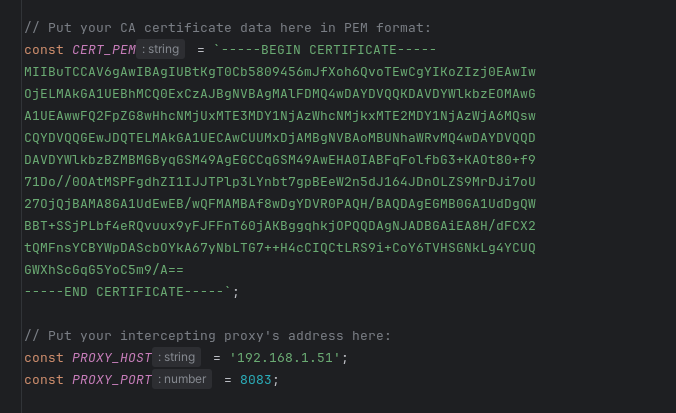

# Frida UnPinning Monster

An all-in-one Frida script for Android that provides **proxy redirection**, **custom CA certificate trust injection**, **SSL/TLS pinning bypass**, and **root detection bypass**.

> **Works Out of the Box on Any Android Application:** This script works seamlessly across **Java/Kotlin**, **Native (C/C++ BoringSSL/OpenSSL)**, and **Flutter** applications without needing any target-specific setup or flags. Every layer is loaded automatically and self-gates based on the libraries present in the app.

## Features

- **Java / Kotlin Unpinning**: Supports OkHttp (v2/v3), `HttpsURLConnection`, Conscrypt, `NetworkSecurityConfig`, TrustKit, Appcelerator, Cordova/PhoneGap, IBM WorkLight, Netty, Appmattus Certificate Transparency, and includes an automatic fallback error-patcher for obfuscated classes.
- **Native TLS Unpinning**: Hooks BoringSSL and OpenSSL (`libssl.so`, `libsscronet.so`, `boringssl`).
- **Flutter Unpinning**: Bypasses certificate verification in `libflutter.so` (Dart's BoringSSL) across `arm64`, `arm`, `x64`, and `x86` architectures (including obfuscated release builds).
- **Proxy Redirection**: Redirects raw TCP socket connections (`connect` hook) and overrides JVM/Android system proxy settings, `ConnectivityManager`, and `ProxySelector`s.
- **HTTP/3 (QUIC) Blocking**: Blocks UDP port 443 by default so apps fall back to interceptable TCP traffic.
- **Selective CA Trust**: Injects your specific proxy CA certificate into trust stores instead of blindly trusting all certificates.
- **Root Detection Bypass**: Spoofs build properties and hides common root files, packages (`Magisk`, `KernelSU`, `SuperSU`), and shell commands.
- **Frida 16 & 17+ Ready**: Bundles `frida-java-bridge` and module observer shims for out-of-the-box compatibility.

## Requirements

- Rooted Android device or emulator.
- `frida-server` (16.x or 17.x) running as root on the device.
- An intercepting proxy (e.g., Caido, Burp Suite, mitmproxy, HTTP Toolkit) running before launching the target app.

## Configuration

Open `Frida-unpinning-monster.js` and edit the configuration constants near line 2069:



| Variable | Description | Default |
| :--- | :--- | :--- |
| `CERT_PEM` | Your proxy's CA certificate in PEM format (`-----BEGIN CERTIFICATE-----...`) | *(Sample Caido Cert)* |
| `PROXY_HOST` | IP address of your proxy (use `127.0.0.1` with `adb reverse`, or your machine's LAN IP) | `'192.168.1.51'` |
| `PROXY_PORT` | Port your intercepting proxy is listening on | `8083` |
| `DEBUG_MODE` | Enable verbose logging for hooks and connection redirection | `false` |
| `BLOCK_HTTP3` | Block outgoing UDP connections on port 443 to force HTTP/1.1 or HTTP/2 over TCP | `true` |
| `IGNORED_NON_HTTP_PORTS` | Array of ports to exclude from native TCP redirection | `[]` |
| `PROXY_SUPPORTS_SOCKS5` | Route non-HTTP native traffic via SOCKS5 handshake | `false` |

## Quick Start

1. **Configure your CA Certificate and Proxy** inside `Frida-unpinning-monster.js`.
2. **(Optional) Port-forward via ADB** if using `127.0.0.1` as `PROXY_HOST`:
   ```bash
   adb reverse tcp:8083 tcp:8083
   ```
3. **Spawn the target application with Frida**:
   ```bash
   frida -U -f <package.name> -l Frida-unpinning-monster.js --no-pause
   ```
   > **Note:** Always prefer spawning with `-f` over attaching (`-n`) so hooks are installed before the app caches its SSL context.
